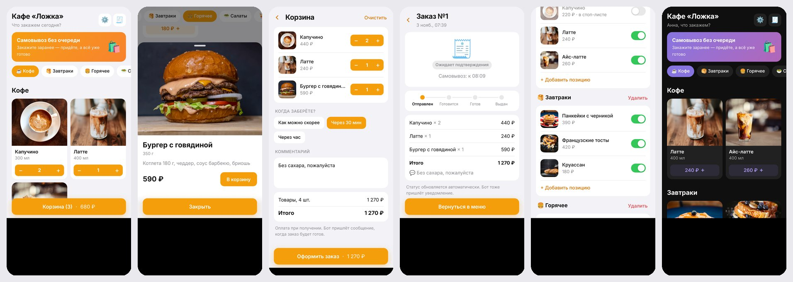

# Кафе «Ложка» — Telegram Mini App для заказа еды

Меню кафе с корзиной и оформлением заказа прямо в Telegram. Заказ приходит владельцу
в чат с кнопками «Принят» / «Готов», а клиент получает уведомления о смене статуса.



## Что умеет

**Для клиента**
- Каталог с категориями, фото, весом и карточкой блюда
- Корзина и оформление через нативную кнопку Telegram (`MainButton`), навигация через `BackButton`
- Время самовывоза и комментарий к заказу
- Экран заказа с «живым» статусом и историей заказов
- Тема Telegram пользователя (светлая/тёмная, любые цвета) подхватывается автоматически
- Тактильная отдача (Haptic Feedback), подтверждение перед закрытием с непустой корзиной

**Для владельца**
- Новый заказ приходит в личку или в группу сотрудников с кнопками
  `✅ Принят → 🍽 Готов → 🤝 Выдан` (и `❌ Отменить`)
- Сообщение с заказом обновляется при смене статуса, клиенту уходит уведомление
- Админка прямо в Mini App: стоп-лист одним переключателем, цены, новые позиции и категории

**Безопасность**
- Бэкенд проверяет HMAC-подпись `initData` по
  [алгоритму Telegram](https://core.telegram.org/bots/webapps#validating-data-received-via-the-mini-app)
  и срок её действия. Подделать пользователя или админа нельзя.
- Цены и наличие берутся только из БД: клиент присылает лишь `id` и количество
- Защита от двойного нажатия кнопок статуса (переход только из допустимого статуса)

## Стек

| Часть    | Технологии |
|----------|------------|
| Фронтенд | React 19, TypeScript, Vite, `telegram-web-app.js` |
| Бэкенд   | Python 3.13, FastAPI, aiogram 3, SQLite (aiosqlite) |
| Тесты    | pytest: проверка подписи initData, API, переходы статусов, кнопки бота |
| Деплой   | Vercel/Netlify (фронт), Docker → Render или VPS (бэкенд), GitHub Actions CI |

```
backend/
  app/auth.py    — проверка initData
  app/api.py     — REST API (меню, заказы, админка)
  app/bot.py     — бот: /start, заказы владельцу, кнопки статусов, уведомления
  app/db.py      — схема SQLite и демо-меню
  app/main.py    — FastAPI + бот в одном процессе
frontend/src/
  telegram.ts    — обёртка над Telegram.WebApp
  components/TgButtons.tsx — MainButton/BackButton (с фолбэком для браузера)
  screens/       — меню, корзина, заказ, история, админка
```

## Быстрый старт

### 1. Бот

1. В [@BotFather](https://t.me/BotFather): `/newbot` → получите `BOT_TOKEN`.
2. Mini App привязывается к кнопке меню бота автоматически при запуске бэкенда
   (если задан `WEBAPP_URL`). По желанию сделайте прямую ссылку через `/newapp`.

### 2. Бэкенд

```bash
cd backend
python -m venv .venv && source .venv/bin/activate
pip install -r requirements-dev.txt
cp .env.example .env        # впишите BOT_TOKEN, WEBAPP_URL
uvicorn app.main:app --reload --port 8000
```

Напишите боту `/id`: он покажет ваш `user_id`, его нужно вписать в `OWNER_CHAT_ID` и `ADMIN_IDS`.
Чтобы заказы получали сотрудники, добавьте бота в группу, отправьте там `/id` и укажите
id группы в `OWNER_CHAT_ID`.

Тесты: `pytest -q`

### 3. Фронтенд

```bash
cd frontend
npm install
npm run dev                 # http://localhost:5173, /api проксируется на :8000
```

Чтобы открыть приложение в обычном браузере без Telegram, запустите бэкенд с `DEV_MODE=1`.
Запросы без initData тогда идут от тестового пользователя с правами админа, а вместо
нативных кнопок Telegram рисуются обычные. **На проде `DEV_MODE` не включайте.**

### 4. Проверка с телефона

Telegram открывает Mini App только по HTTPS. Для разработки поднимите туннель:

```bash
cloudflared tunnel --url http://localhost:5173
# или: ngrok http 5173
```

Полученный `https://…` адрес укажите в `WEBAPP_URL` и перезапустите бэкенд. Фронт ходит
в API через прокси Vite, поэтому хватает одного туннеля.

## Деплой

**Фронтенд → Vercel или Netlify**
- Root directory: `frontend`, build: `npm run build`, output: `dist`
- Переменная `VITE_API_URL=https://ваш-бэкенд`

**Бэкенд → Render**: в репозитории есть `render.yaml` (New → Blueprint).
Бот работает через long polling, а SQLite хранится на диске, поэтому нужен план без
засыпания и с постоянным диском (Starter). На бесплатном плане инстанс засыпает и база
сбрасывается при каждом деплое.

**Бэкенд → VPS**: `docker compose up -d --build`, сверху HTTPS через Caddy или nginx.

После деплоя пропишите в бэкенде `WEBAPP_URL` (адрес фронта) и `CORS_ORIGINS`
(тот же адрес).

## API

| Метод | Путь | Доступ |
|-------|------|--------|
| GET | `/api/menu` | все |
| GET | `/api/me` | пользователь |
| POST | `/api/orders` | пользователь |
| GET | `/api/orders`, `/api/orders/{id}` | пользователь (только свои) |
| GET | `/api/admin/menu` | админ |
| POST/PATCH/DELETE | `/api/admin/items[/{id}]` | админ |
| POST/PATCH/DELETE | `/api/admin/categories[/{id}]` | админ |

Авторизация: заголовок `Authorization: tma <Telegram.WebApp.initData>`.

---

Фото блюд взяты с [Unsplash](https://unsplash.com).
